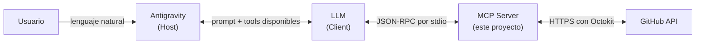
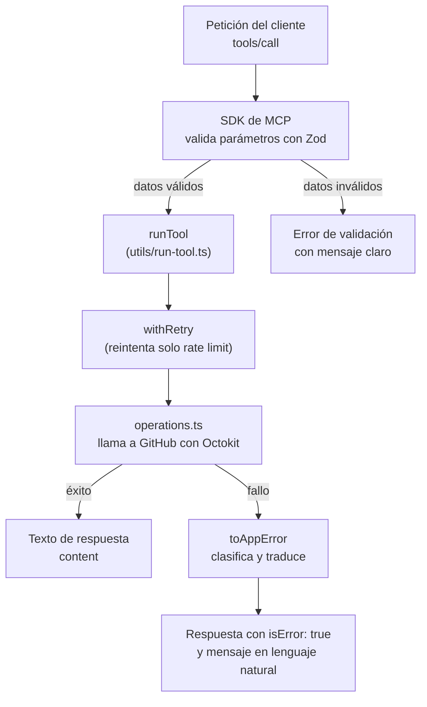

# ProyectoM5-AndyOchoa
# GitHub MCP Server

Servidor [MCP (Model Context Protocol)](https://modelcontextprotocol.io) hecho con Node.js y TypeScript que permite a un agente de IA ejecutar acciones en GitHub a partir de instrucciones en lenguaje natural. Se conecta a **Antigravity** por stdio y expone 5 herramientas (*tools*) para crear repositorios, abrir issues, hacer commits y consultar información.

> *"Crea un repositorio privado llamado demo-app, abre un issue 'Configurar CI' y sube un README"* → el agente decide qué tools usar y las ejecuta en tu cuenta de GitHub.

---

## Tabla de contenido

1. [¿Por qué es útil?](#por-qué-es-útil)
2. [Arquitectura](#arquitectura)
3. [Requisitos](#requisitos)
4. [Instalación](#instalación)
5. [Configuración](#configuración)
6. [Tools disponibles](#tools-disponibles)
7. [Ejemplos de uso](#ejemplos-de-uso)
8. [Manejo de errores](#manejo-de-errores)
9. [Tests](#tests)
10. [Scripts](#scripts)
11. [Estructura del proyecto](#estructura-del-proyecto)
12. [Troubleshooting](#troubleshooting)
13. [Seguridad](#seguridad)
14. [Licencia](#licencia)

---

## ¿Por qué es útil?

Las tareas repetitivas en GitHub (crear repos de práctica, abrir issues, subir archivos de configuración, revisar pendientes) obligan a cambiar de herramienta y rellenar formularios. Con este servidor se piden en una frase, sin salir del IDE.

Casos de uso:

- **Arrancar proyectos rápido:** crear el repositorio y subir los primeros archivos desde el chat.
- **Gestión de pendientes:** abrir issues mientras se programa y consultar los que siguen abiertos.
- **Automatización por lotes:** pedirle al agente que abra un issue por cada error que encontró en una revisión.
- **Demostraciones y formación:** mostrar cómo un agente de IA usa herramientas reales a través de MCP.

### Características

- 5 tools de GitHub con validación de entradas mediante **Zod**.
- Errores clasificados en 4 tipos y traducidos a **mensajes en lenguaje natural** que el LLM puede comunicar.
- **Reintentos con espera exponencial** ante rate limiting.
- **Logging por niveles** (a stderr) que oculta tokens automáticamente.
- Más de 50 tests unitarios con **Vitest** y Octokit mockeado.

---

## Arquitectura



En la práctica, Antigravity incorpora el cliente MCP: lanza este servidor como proceso hijo y se comunica con él por **stdio** (stdin para recibir peticiones, stdout para responder). El LLM no ejecuta nada: solo lee las descripciones de las tools y decide cuál usar y con qué parámetros.

### Qué pasa por dentro cuando se ejecuta una tool



Decisiones de diseño principales:

- **Capas separadas:** `operations.ts` solo habla con GitHub y no sabe nada de MCP; las tools solo conectan MCP con las operaciones. Esto permite probar cada capa por separado.
- **Manejo de errores centralizado:** `runTool` envuelve las 5 tools, de modo que ninguna repite lógica de errores, reintentos o logs.
- **Logs por stderr:** stdout está reservado al protocolo MCP; escribir ahí lo rompería.

---

## Requisitos

- **Node.js 18 o superior** (`node -v` para comprobarlo)
- **npm** (incluido con Node.js)
- Una cuenta de **GitHub** y un [Personal Access Token](#1-obtener-un-personal-access-token)
- **Antigravity** (u otro cliente compatible con MCP)

---

## Instalación

```bash
# 1. Clonar el repositorio
git clone https://github.com/andy202ochoa/ProyectoM5-AndyOchoa.git
cd ProyectoM5-AndyOchoa

# 2. Instalar dependencias
npm install

# 3. Compilar TypeScript
npm run build
```

Al terminar debe existir el archivo `dist/server.js`.

---

## Configuración

### 1. Obtener un Personal Access Token

1. En GitHub, haz clic en tu foto de perfil → **Settings**.
2. Al final del menú izquierdo, entra en **Developer settings**.
3. Ve a **Personal access tokens → Tokens (classic)**.
4. Pulsa **Generate new token → Generate new token (classic)**.
5. Ponle un nombre (por ejemplo `mcp-github-server`) y una expiración corta (30 días, por ejemplo).
6. Marca los scopes necesarios (ver tabla siguiente).
7. Pulsa **Generate token** y **copia el token en ese momento**: GitHub no vuelve a mostrarlo.

> Los menús de GitHub cambian de vez en cuando; si algún nombre no coincide exactamente, busca el equivalente.

**Scopes del token**

| Scope | Para qué sirve | ¿Necesario? |
|---|---|---|
| `repo` | Crear repositorios, issues y commits, y leer repositorios privados | **Sí** |
| `user` | Leer datos del perfil del usuario autenticado | Lo pide la especificación del proyecto |
| `admin:org` | Administrar organizaciones | Lo pide la especificación; solo hace falta para trabajar con organizaciones y es un permiso muy amplio |

Si no vas a usar organizaciones, puedes omitir `admin:org` y dar así el mínimo de permisos.

### 2. Configurar el archivo `.env`

Copia la plantilla y rellena tu token:

```bash
cp .env.example .env
```

```env
GITHUB_TOKEN=pega_aqui_tu_token
LOG_LEVEL=info
```

| Variable | Descripción | Por defecto |
|---|---|---|
| `GITHUB_TOKEN` | Personal Access Token de GitHub (**obligatoria**) | — |
| `LOG_LEVEL` | Nivel de logs: `debug`, `info`, `warn` o `error` | `info` |

> El archivo `.env` está en el `.gitignore`. **Nunca lo subas al repositorio.**

El servidor busca el `.env` en la raíz del proyecto a partir de la ubicación de sus propios archivos, así que funciona aunque el cliente MCP lo lance desde otra carpeta.

### 3. Configurar el servidor en Antigravity

1. En el panel del **Agente**, abre el menú de opciones adicionales (**⋯**) → **MCP Servers** → **Manage MCP Servers** → **View raw config**. Se abre el archivo `mcp_config.json` (normalmente en `~/.gemini/config/`, fuera del proyecto).
2. Añade el servidor dentro de `mcpServers`, usando la **ruta absoluta** a `dist/server.js`:

```json
{
  "mcpServers": {
    "github-mcp-server": {
      "command": "node",
      "args": ["C:/ruta/a/tu/proyecto/dist/server.js"]
    }
  }
}
```

En Windows puedes escribir la ruta con `/` o con `\\` (barra invertida duplicada). En macOS/Linux, por ejemplo: `/Users/tu-usuario/proyectos/github-mcp-server/dist/server.js`.

3. Guarda el archivo y reinicia Antigravity (o pulsa **Refresh** en **Manage MCPs**).
4. Comprueba que `github-mcp-server` aparece conectado con sus 5 tools.

**Alternativa: pasar el token desde la configuración.** Si prefieres no usar `.env`, puedes definirlo en la propia configuración del cliente. Ten en cuenta que así el token queda en texto plano en ese archivo:

```json
{
  "mcpServers": {
    "github-mcp-server": {
      "command": "node",
      "args": ["C:/ruta/a/tu/proyecto/dist/server.js"],
      "env": { "GITHUB_TOKEN": "tu_token_aqui" }
    }
  }
}
```

> **Importante:** cada vez que cambies código en `src/`, ejecuta `npm run build` de nuevo. Antigravity usa la versión compilada de `dist/`.

### 4. (Opcional) Probar con MCP Inspector

[MCP Inspector](https://github.com/modelcontextprotocol/inspector) es un cliente de pruebas que permite ejecutar las tools sin necesitar un LLM:

```bash
npx @modelcontextprotocol/inspector node dist/server.js
```

Abre la dirección que muestra la terminal, pulsa **Connect** y ve a la pestaña **Tools**.

---

## Tools disponibles

Las descripciones de las tools están escritas para que el LLM sepa cuándo usar cada una. Donde aparece `owner`, si se omite se usa el usuario dueño del token.

### `list_repositories`

Lista los repositorios del usuario autenticado, ordenados por actividad reciente.

| Parámetro | Tipo | Obligatorio | Descripción |
|---|---|---|---|
| `per_page` | number | No (30) | Cantidad de repositorios, entero de 1 a 100 |

**Prompt de ejemplo:** *"Muéstrame mis 5 repositorios más recientes"*

### `create_repository`

Crea un repositorio nuevo en la cuenta del usuario, inicializado con un README. **Es privado por defecto.**

| Parámetro | Tipo | Obligatorio | Descripción |
|---|---|---|---|
| `name` | string | Sí | De 3 a 100 caracteres: letras, números y guiones |
| `description` | string | No | Hasta 350 caracteres |
| `private` | boolean | No (`true`) | `true` privado, `false` público |

**Prompt de ejemplo:** *"Crea un repositorio privado llamado demo-app con la descripción 'Mi primera app con MCP'"*

### `create_issue`

Abre un issue en un repositorio existente.

| Parámetro | Tipo | Obligatorio | Descripción |
|---|---|---|---|
| `owner` | string | No | Usuario u organización dueña del repo |
| `repo` | string | Sí | Nombre del repositorio, sin el dueño |
| `title` | string | Sí | Título, de 1 a 256 caracteres |
| `body` | string | No | Descripción en Markdown |

**Prompt de ejemplo:** *"Abre un issue en demo-app con el título 'Configurar CI' y el cuerpo 'Agregar un workflow de GitHub Actions'"*

### `create_commit`

Crea un archivo nuevo o reemplaza el contenido de uno existente, generando un commit.

| Parámetro | Tipo | Obligatorio | Descripción |
|---|---|---|---|
| `owner` | string | No | Usuario u organización dueña del repo |
| `repo` | string | Sí | Nombre del repositorio |
| `path` | string | Sí | Ruta del archivo, sin `/` inicial ni final y sin `..` |
| `content` | string | Sí | Contenido completo del archivo (máx. 100.000 caracteres) |
| `message` | string | Sí | Mensaje del commit (de 1 a 300 caracteres) |
| `branch` | string | No | Rama destino; si se omite, la rama principal. Debe existir |

> Si el archivo ya existe, su contenido se **reemplaza por completo**.

**Prompt de ejemplo:** *"En demo-app crea el archivo docs/guia.md con el texto '# Guía' y haz commit con el mensaje 'Agrega guía'"*

### `list_issues`

Lista los issues **abiertos** de un repositorio (excluye los pull requests).

| Parámetro | Tipo | Obligatorio | Descripción |
|---|---|---|---|
| `owner` | string | No | Usuario u organización dueña del repo |
| `repo` | string | Sí | Nombre del repositorio |
| `per_page` | number | No (30) | Cantidad de issues, entero de 1 a 100 |

**Prompt de ejemplo:** *"¿Qué issues abiertos tiene demo-app?"*

---

## Ejemplos de uso

**Flujo completo de un proyecto nuevo**

> *"Crea un repositorio privado llamado demo-mcp, sube un archivo README.md con el título 'Demo' y abre un issue llamado 'Primeros pasos'."*

El agente encadena `create_repository` → `create_commit` → `create_issue`.

**Revisar pendientes**

> *"Lista mis repositorios y dime cuáles tienen issues abiertos."*

Usa `list_repositories` y luego `list_issues` sobre los repos relevantes.

**Repositorio de otra persona**

> *"Muéstrame los issues abiertos de facebook/react."*

El agente envía `owner = facebook` y `repo = react`.

**Cuando algo falla**

> *"Lista los issues del repo no-existe-xyz."*

El agente responde con el mensaje del servidor: *El repositorio "no-existe-xyz" no fue encontrado. Verifica el nombre e intenta de nuevo...*

---

## Manejo de errores

Los errores se clasifican en cuatro tipos y se traducen a mensajes que el LLM puede comunicar al usuario. El detalle técnico se registra en los logs pero **no se envía al LLM**.

| Tipo | Cuándo ocurre | Ejemplo de mensaje |
|---|---|---|
| `ValidationError` | Los datos enviados no cumplen las reglas | *"La ruta no debe empezar con '/'..."* |
| `AuthenticationError` | Falta el token o es inválido (401) | *"El token de GitHub no es válido o expiró..."* |
| `NetworkError` | No hay conexión con GitHub | *"No se pudo conectar con GitHub. Revisa tu conexión..."* |
| `GitHubAPIError` | GitHub respondió con un error | *"El repositorio X no fue encontrado..."* |

Códigos HTTP tratados dentro de `GitHubAPIError`: 403 (permisos), 404 (no encontrado), 409 (conflicto), 422 (datos rechazados, por ejemplo nombre duplicado), 5xx (problemas de GitHub) y rate limiting.

**Reintentos.** Solo se reintenta ante **rate limiting** (HTTP 429, o 403 con el límite agotado), porque en ese caso GitHub no ejecutó la petición y repetirla es seguro. Se hacen hasta 3 reintentos con espera exponencial (1 s, 2 s, 4 s) y se respeta la cabecera `Retry-After`. Si GitHub pide esperar más de 10 segundos, se devuelve un error claro en vez de dejar al usuario esperando.

**Logging.** Los logs van a **stderr** con niveles `debug`, `info`, `warn` y `error` (configurables con `LOG_LEVEL`). Antes de escribir, se tapan los tokens de GitHub, tanto por su formato como por el valor exacto de `GITHUB_TOKEN`. Los logs no incluyen el contenido de los archivos ni los datos de entrada.

---

## Tests

```bash
npm test
```

Los tests usan **Vitest** y no necesitan token ni conexión a internet: Octokit se reemplaza por un mock.

| Archivo | Qué cubre |
|---|---|
| `tests/tools.test.ts` | Validación de los schemas de Zod (entradas válidas e inválidas) |
| `tests/github.test.ts` | Operaciones de GitHub con Octokit mockeado y casos límite |
| `tests/errors.test.ts` | Clasificación y traducción de errores a lenguaje natural |
| `tests/retry.test.ts` | Reintentos con espera exponencial (sin esperas reales) |
| `tests/run-tool.test.ts` | Envoltorio de las tools: formato de respuesta y errores |
| `tests/logging.test.ts` | Que los tokens se oculten en los logs |

---

## Scripts

| Comando | Qué hace |
|---|---|
| `npm run build` | Compila TypeScript a la carpeta `dist/` |
| `npm run dev` | Ejecuta el servidor directamente desde `src/` (con `tsx`) |
| `npm start` | Ejecuta la versión compilada (`dist/server.js`) |
| `npm test` | Ejecuta los tests con Vitest |

---

## Estructura del proyecto

```
├── src/
│   ├── server.ts                 # Punto de entrada: crea el servidor y registra las tools
│   ├── tools/                    # Una tool por archivo (nombre, descripción, schema, handler)
│   │   ├── create-repository.ts
│   │   ├── create-issue.ts
│   │   ├── list-repositories.ts
│   │   ├── create-commit.ts
│   │   └── list-issues.ts
│   ├── schemas/index.ts          # Schemas de Zod de cada tool
│   ├── github/
│   │   ├── client.ts             # Configuración de Octokit y lectura del token
│   │   └── operations.ts         # Funciones que llaman a la API de GitHub
│   ├── errors/index.ts           # Tipos de error y traducción a lenguaje natural
│   └── utils/
│       ├── logging.ts            # Logger por niveles con redacción de tokens
│       ├── retry.ts              # Reintentos con backoff exponencial
│       └── run-tool.ts           # Envoltorio común de las tools
├── tests/                        # Tests unitarios con Vitest
├── .env.example                  # Plantilla de variables de entorno (sin valores reales)
├── .gitignore
├── tsconfig.json
├── vitest.config.ts
├── package.json
└── README.md
```

---

## Troubleshooting

| Problema | Qué revisar |
|---|---|
| El servidor no aparece o sale en rojo en Antigravity | Que exista `dist/server.js` (`npm run build`), que la ruta en `args` sea absoluta y correcta, que el JSON no tenga comas de más o de menos y que `node -v` funcione en tu terminal. Reinicia Antigravity. |
| *"No se encontró el token de GitHub"* | Que el archivo `.env` esté en la raíz del proyecto y contenga `GITHUB_TOKEN=...` sin espacios ni comillas de más. |
| *"El token de GitHub no es válido o expiró"* | Genera un token nuevo y actualiza el `.env`. Reinicia el servidor: el `.env` se lee al arrancar. |
| *"No tienes permisos para realizar esta acción"* | Revisa que el token tenga el scope `repo` y que tengas acceso al repositorio. |
| Cambié el código y no se nota | Ejecuta `npm run build` y refresca el servidor en Antigravity. |
| Faltan tools en la lista | `dist/` está desactualizado: vuelve a compilar. |
| *"Ya existe un repositorio con ese nombre"* | Elige otro nombre; GitHub no permite duplicados en la misma cuenta. |
| *"Se alcanzó el límite de peticiones de GitHub"* | Espera unos minutos; el límite se reinicia cada hora. |
| Error de módulo no encontrado al ejecutar | Ejecuta `npm install` y `npm run build`. |
| Quiero ver más detalle en los logs | Pon `LOG_LEVEL=debug` en el `.env` y reinicia. |

> **Regla para desarrollar:** nunca uses `console.log` en el código del servidor. Escribe en stdout rompe el protocolo MCP; usa el `logger` de `src/utils/logging.ts`, que escribe en stderr.

---

## Seguridad

- El token **nunca** debe subirse al repositorio: `.env` está en el `.gitignore`.
- Usa una expiración corta y los scopes mínimos que necesites.
- Si subes un token por accidente a un repositorio público, **revócalo de inmediato** en GitHub y genera uno nuevo.
- `create_repository` crea repositorios **privados por defecto**, y las rutas de `create_commit` se validan para impedir `..` y rutas absolutas.
- Los logs ocultan tokens y no registran el contenido de los archivos.

---

## Licencia

Distribuido bajo la licencia [MIT](./LICENSE).